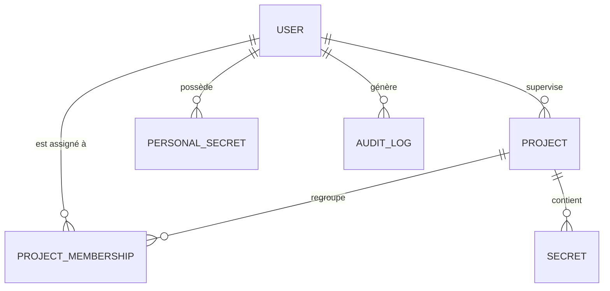

# KeyVault

    

> Coffre-fort de secrets d'équipe : partagez les variables d'environnement de vos projets sans jamais passer par WhatsApp ou Gmail.

## Le problème

Les clés d'API et fichiers `.env` circulent par WhatsApp, Gmail, Google Drive. Résultat : les clés sont copiées partout, impossible de les révoquer, et personne ne sait qui y a eu accès.

## La solution

Un site web interne où :

- les secrets sont **chiffrés au repos** (AES-256-GCM) : même une base de données volée ne révèle rien ;
- l'accès est **restreint par projet** : seul un membre assigné peut consulter un secret ;
- les valeurs sont **masquées par défaut** et se masquent automatiquement 30 s après révélation ;
- chaque révélation / export est **journalisé** (audit immuable) ;
- l'**admin crée les comptes** : aucune inscription libre, mot de passe temporaire imposé à la première connexion ;
- chacun dispose d'un **coffre personnel privé**, invisible même pour l'admin.

## Fonctionnalités du MVP

- [x] Authentification : connexion / déconnexion, sessions httpOnly (JWT HS256)
- [x] Comptes créés par l'admin uniquement + mot de passe temporaire + changement forcé
- [x] 3 rôles : ADMIN / SUPERVISEUR / MEMBRE (voir matrice ci-dessous)
- [x] Projets avec superviseur désigné et membres assignés
- [x] Secrets chiffrés : ajout, édition, suppression, révélation 30 s, copie, export `.env`
- [x] Coffre personnel privé pour chaque utilisateur
- [x] Journal d'audit : global (admin), par projet (superviseur), personnel (membre)

## Rôles et permissions

| Action | ADMIN | SUPERVISEUR | MEMBRE |
|---|---|---|---|
| Créer des comptes | Oui | Non | Non |
| Créer / supprimer un projet | Oui | Non | Non |
| Assigner des membres à un projet | Tous projets | Ses projets | Non |
| Gérer les secrets | Tous projets | Ses projets | Non |
| Révéler / copier / exporter | Projets assignés | Ses projets | Projets assignés |
| Coffre personnel | Oui | Oui | Oui |
| Journal d'audit | Global | Ses projets | Son activité |

> Par moindre privilège, l'admin ne peut pas révéler les valeurs des projets où il n'est pas assigné : qui gère les comptes n'a pas besoin de lire les secrets.

## Sécurité

- Mots de passe hachés avec bcrypt (coût 10), jamais stockés en clair.
- Secrets chiffrés avec AES-256-GCM : IV unique par chiffrement, tag d'authentification, clé maître hors base (`APP_ENCRYPTION_KEY`).
- Sessions par cookie httpOnly (inaccessible au JavaScript du navigateur), SameSite=Lax, revalidées en base à chaque requête (désactivation de compte immédiatement effective).
- Moindre privilège vérifié sur chaque route (session + rôle + assignation).
- Valeurs de secrets jamais journalisées, jamais mises en cache, retournées uniquement sur révélation / export explicite (`Cache-Control: no-store`).
- Journal d'audit immuable (aucune route d'écriture, aucune valeur de secret).
- Messages d'erreur de connexion génériques (pas d'énumération de comptes).

## Stack technique

| Couche | Choix |
|---|---|
| Framework | Next.js 16 (App Router) + TypeScript 5 |
| Interface | Tailwind CSS 4 + shadcn/ui + Lucide |
| API | Routes API REST (`/api/*`) |
| Auth | bcryptjs + jose (JWT) + cookie httpOnly |
| Chiffrement | AES-256-GCM (module `crypto` de Node.js) |
| Base de données | PostgreSQL 16 |
| ORM | Prisma |
| Infrastructure | Docker (PostgreSQL + Adminer) |

## Modèle de données



## Démarrage rapide

### Prérequis

- Docker Desktop (ou Docker Engine + Compose)
- Bun (recommandé) ou Node.js 20+
- openssl (inclus sur macOS / Linux ; disponible via Git Bash sur Windows)

### Installation

```bash
# 1. Installer les dépendances
bun install            # ou : npm install

# 2. Préparer les variables d'environnement
cp .env.example .env
# puis générer les deux clés et les coller dans .env :
#   openssl rand -hex 32   ->  APP_ENCRYPTION_KEY
#   openssl rand -hex 32   ->  SESSION_SECRET

# 3. Démarrer PostgreSQL + Adminer
docker compose up -d

# 4. Créer le schéma en base
bunx prisma db push    # ou : npm run db:push

# 5. Créer le compte administrateur initial
bun run db:seed

# 6. Lancer l'application
bun run dev            # ou : npm run dev
```

Puis ouvrir http://localhost:3000 et se connecter avec le compte admin défini dans `.env` (`ADMIN_EMAIL` / `ADMIN_PASSWORD`).

### Inspecter la base avec Adminer

Adminer est démarré avec PostgreSQL : http://localhost:8080

| Champ | Valeur |
|---|---|
| Système | PostgreSQL |
| Serveur | db |
| Utilisateur | keyvault |
| Mot de passe | keyvault |
| Base | keyvault |

Pratique pour constater par soi-même que les valeurs de secrets stockées sont illisibles (chiffrées, base64).

## Variables d'environnement

| Variable | Description |
|---|---|
| `DATABASE_URL` | Connexion PostgreSQL utilisée par Prisma |
| `APP_ENCRYPTION_KEY` | Clé maître AES-256-GCM des secrets (64 caractères hex, via `openssl rand -hex 32`) |
| `SESSION_SECRET` | Clé de signature des JWT de session (64 caractères hex) |
| `ADMIN_NAME` | Nom du compte admin initial (seed) |
| `ADMIN_EMAIL` | E-mail du compte admin initial |
| `ADMIN_PASSWORD` | Mot de passe initial du premier admin (à changer après connexion) |

Avertissements :

- ne jamais commiter le fichier `.env` (il est ignoré par git) ;
- si `APP_ENCRYPTION_KEY` change, tous les secrets chiffrés deviennent définitivement illisibles ;
- changer ces valeurs et les mots de passe en production.

## Structure du projet

```
src/
  app/
    page.tsx              # Interface unique (SPA, bascule de vues côté client)
    api/
      auth/               # login, logout, me, change-password
      members/            # gestion des comptes (admin)
      projects/           # projets, assignations, secrets, export .env
      me/                 # coffre personnel et activité
      audit/              # journal d'audit
  components/
    ui/                   # Composants shadcn/ui
    kv/                   # Vues de l'application (KeyVault)
  lib/
    db.ts                 # Client Prisma
    auth.ts               # Sessions JWT
    access.ts             # Contrôle d'accès RBAC (moindre privilège)
    crypto.ts             # Chiffrement AES-256-GCM
    audit.ts              # Journalisation (sans valeur de secret)
prisma/
  schema.prisma           # Modèle de données
  seed.ts                 # Compte admin initial
docs/
  CAHIER_DE_CHARGE.md     # Spécifications complètes
docker-compose.yml        # PostgreSQL + Adminer
```

## Statut

**MVP fonctionnel.** Les 12 critères d'acceptation du cahier des charges (CA1 à CA12) sont implémentés et vérifiés manuellement : matrice de permissions, révélation temporaire 30 s, changement de mot de passe forcé, désactivation de compte immédiate, confidentialité du coffre personnel face à l'admin, journal d'audit sans valeurs de secrets, export `.env` trié.

## Roadmap v2

- Invitations par e-mail
- Environnements multiples (dev / staging / prod)
- Historique des versions et rollback des secrets
- Liens de partage temporaires avec expiration
- Authentification à deux facteurs (2FA)
- CLI et API pour CI/CD
- Rotation de la clé maître

## Licence

MIT
