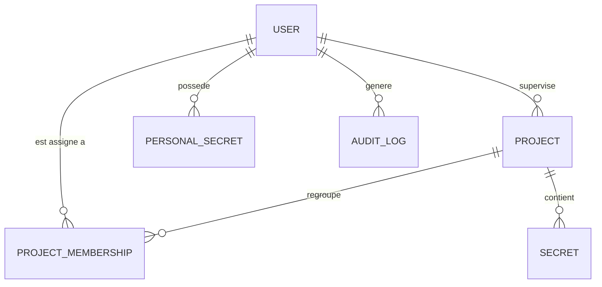

# Cahier des charges — KeyVault

> Coffre-fort interne pour le partage sécurisé des variables d'environnement d'une équipe.

| | |
|---|---|
| Version du document | 1.0 |
| Statut | Validé — prêt pour le développement |
| Équipe cible | Environ 20 personnes au démarrage |
| Stack décidée | Next.js 16 (App Router), TypeScript, PostgreSQL 16 (Docker local), Prisma ORM |

---

## 1. Contexte et problématique

Aujourd'hui, les clés d'API, identifiants de base de données et autres variables d'environnement (fichiers `.env`) circulent dans l'équipe par des canaux inadaptés : WhatsApp, Gmail, Google Drive, etc.

Conséquences :

- les clés sont copiées dans des dizaines de conversations et de boîtes mail, hors de tout contrôle ;
- il est impossible de révoquer un partage : la clé reste dans l'historique du canal ;
- personne ne sait qui a eu accès à quoi, ni quand ;
- un membre qui quitte l'équipe repart avec toutes les clés déjà partagées.

KeyVault répond à ce problème : un site web interne où les secrets sont stockés chiffrés, accessibles uniquement aux personnes assignées, avec une traçabilité complète.

## 2. Objectifs

### 2.1 Objectif produit

Fournir aux équipes un point d'accès unique et sécurisé aux variables d'environnement de chaque projet, remplaçant le partage par messagerie.

### 2.2 Objectifs pédagogiques

Ce projet est aussi un support d'apprentissage des notions fondamentales du développement web moderne :

- authentification par e-mail / mot de passe (hachage bcrypt, sessions par cookie httpOnly + JWT) ;
- contrôle d'accès basé sur les rôles (RBAC) ;
- chiffrement au repos (AES-256-GCM) ;
- conception d'une API REST ;
- journalisation d'audit ;
- relations entre entités avec un ORM (Prisma) sur une base PostgreSQL administrée par Docker.

## 3. Périmètre

### 3.1 Inclus dans le MVP

1. Authentification : connexion, déconnexion, session sécurisée.
2. Gestion des comptes par l'administrateur : création, changement de rôle, désactivation, réinitialisation de mot de passe.
3. Changement de mot de passe obligatoire à la première connexion.
4. Projets : création, liste filtrée par rôle, suppression (admin).
5. Désignation d'un superviseur par projet (admin).
6. Assignation de membres à un projet (superviseur du projet ou admin).
7. Secrets de projet : ajout, modification, suppression (superviseur/admin), consultation masquée, révélation à la demande (masquage automatique après 30 s), copie, export du fichier `.env`.
8. Espace personnel : profil, changement de mot de passe, coffre personnel, historique d'activité personnelle.
9. Journal d'audit dont la visibilité dépend du rôle.

### 3.2 Hors périmètre (reporté en v2 et au-delà)

- invitations par e-mail ;
- environnements multiples par projet (dev / staging / prod) ;
- historique des versions d'un secret et rollback ;
- liens de partage temporaires avec expiration ;
- authentification à deux facteurs (2FA) ;
- CLI et API dédiées pour les pipelines CI/CD ;
- rotation de la clé maître de chiffrement ;
- organisations multiples ;
- recherche avancée et pagination étendue.

## 4. Utilisateurs et rôles

### 4.1 Les trois rôles

| Rôle | Description |
|---|---|
| **ADMIN** | Administrateur de la plateforme. Crée les comptes, crée les projets, désigne les superviseurs. Ne voit PAS les valeurs des secrets des projets où il n'est pas assigné (moindre privilège). |
| **SUPERVISEUR** | Responsable d'un ou plusieurs projets. Gère les secrets et les membres de SES projets. |
| **MEMBRE** | Utilisateur standard. Consulte, révèle et exporte les secrets des projets auxquels il est assigné. |

Notes :

- le premier compte (administrateur initial) est créé par le script de seed au premier démarrage ;
- un superviseur reste un membre pour les projets qu'il ne supervise pas ;
- l'assignation d'un admin à un projet lui donne les mêmes droits de lecture que tout membre assigné.

### 4.2 Matrice des permissions

| Action | ADMIN | SUPERVISEUR | MEMBRE |
|---|---|---|---|
| Se connecter / changer son mot de passe | Oui | Oui | Oui |
| Créer des comptes | Oui | Non | Non |
| Modifier un rôle / désactiver / réinitialiser un mot de passe | Oui | Non | Non |
| Créer / supprimer un projet | Oui | Non | Non |
| Désigner le superviseur d'un projet | Oui | Non | Non |
| Assigner / retirer des membres d'un projet | Oui (tous) | Oui (ses projets) | Non |
| Ajouter / modifier / supprimer des secrets | Tous projets | Ses projets | Non |
| Voir la liste des clés d'un projet | Oui | Ses projets | Projets assignés |
| Révéler / copier une valeur | Projets où il est assigné | Ses projets | Projets assignés |
| Exporter le fichier `.env` | Projets où il est assigné | Ses projets | Projets assignés |
| Gérer son coffre personnel | Oui | Oui | Oui |
| Journal d'audit | Global | Ses projets | Son activité personnelle |

## 5. Description fonctionnelle

### 5.1 Comptes et authentification

- **Création par l'admin uniquement.** Aucune inscription publique. L'admin saisit : nom, e-mail, rôle (superviseur ou membre). Un mot de passe temporaire est généré automatiquement et affiché une seule fois à l'admin, qui le transmet par un canal approprié (idéalement en personne ou par appel).
- **Première connexion.** Tant que le mot de passe temporaire n'a pas été remplacé (flag `mustChangePassword`), l'utilisateur est forcé d'en définir un nouveau avant d'accéder à l'application.
- **Connexion.** E-mail + mot de passe. En cas d'échec, message générique (sans indiquer si l'e-mail existe) pour empêcher l'énumération de comptes.
- **Session.** JWT signé (HS256) stocké dans un cookie httpOnly, SameSite=Lax, expiration 7 jours. Aucun token lisible par le JavaScript du navigateur.
- **Compte désactivé.** Un compte désactivé par l'admin ne peut plus se connecter ; ses sessions sont invalidées.
- **Réinitialisation.** L'admin peut générer un nouveau mot de passe temporaire pour un membre qui l'a oublié (l'obligation de changement à la connexion se réactive).

### 5.2 Projets

- Chaque projet porte un nom et une description.
- Seul l'admin crée et supprime un projet ; il désigne son superviseur à la création (ou plus tard).
- La liste des projets affichée dépend du rôle : admin → tous ; superviseur → ceux qu'il supervise et ceux où il est assigné ; membre → ceux où il est assigné.

### 5.3 Assignation des accès

- L'accès aux secrets d'un projet passe exclusivement par l'assignation explicite d'un utilisateur au projet (table de liaison).
- Le superviseur d'un projet peut ajouter ou retirer des membres de son projet ; l'admin peut le faire sur tous les projets.
- Retirer un membre d'un projet révoque immédiatement son accès (la prochaine requête est refusée).

### 5.4 Secrets de projet

- Un secret est une paire clé / valeur (ex. `STRIPE_API_KEY = sk_live_...`).
- La clé respecte le format des noms de variables d'environnement : lettres, chiffres et underscores, en commençant par une lettre ou un underscore (validation : `^[A-Za-z_][A-Za-z0-9_]*$`).
- **Masquage par défaut.** Les listes de secrets n'affichent jamais les valeurs, seulement les clés et leurs métadonnées.
- **Révélation à la demande.** Le bouton "révéler" appelle l'API de déchiffrement ; la valeur s'affiche et se masque automatiquement après 30 secondes, puis est retirée de la mémoire du client.
- **Copie.** Copie de la valeur dans le presse-papiers (passe par une révélation côté serveur, donc audité).
- **Export `.env`.** Génère un fichier texte au format `KEY=value`, trié par clé, téléchargeable ; l'action est auditée.
- La modification d'un secret remplace la valeur chiffrée (pas d'historique des versions en MVP).

### 5.5 Espace personnel

Chaque utilisateur (y compris l'admin) dispose de :

- **Mon profil** : consulter ses informations, changer son mot de passe (vérification de l'ancien mot de passe).
- **Mon coffre** : gérer ses secrets personnels (clé/valeur), jamais visibles par quiconque d'autre — y compris l'admin. Même mécanisme de masquage, révélation et copie que les secrets de projet.
- **Mon activité** : historique de ses propres révélations et exports.

### 5.6 Journal d'audit

- Actions enregistrées : `AUTH_LOGIN`, `AUTH_LOGIN_FAILED`, `AUTH_LOGOUT`, `PASSWORD_CHANGED`, `USER_CREATED`, `USER_UPDATED`, `USER_DEACTIVATED`, `PASSWORD_RESET`, `PROJECT_CREATED`, `PROJECT_DELETED`, `MEMBER_ASSIGNED`, `MEMBER_REMOVED`, `SECRET_CREATED`, `SECRET_UPDATED`, `SECRET_DELETED`, `SECRET_REVEALED`, `ENV_EXPORTED`, `PERSONAL_SECRET_CREATED`, `PERSONAL_SECRET_UPDATED`, `PERSONAL_SECRET_DELETED`, `PERSONAL_SECRET_REVEALED`.
- Chaque entrée contient : horodatage, auteur, action, projet concerné (le cas échéant), détail synthétique. **Aucune valeur de secret n'est jamais journalisée.**
- Le journal est en lecture seule : aucune route de modification ni de suppression.
- Visibilité : admin → tout ; superviseur → les actions liées à ses projets ; membre → son propre historique via "Mon activité".

## 6. Exigences de sécurité

1. **Hachage des mots de passe** : bcrypt (coût 10 ou plus). Jamais de mot de passe en clair, ni en base, ni dans les logs.
2. **Chiffrement au repos** : chaque valeur de secret est chiffrée en AES-256-GCM avec un IV unique par chiffrement ; la clé maître provient de la variable d'environnement `APP_ENCRYPTION_KEY` du serveur (jamais stockée en base).
3. **Moindre privilège** : chaque route API vérifie session + rôle + assignation ; l'admin lui-même ne peut pas déchiffrer les secrets des projets où il n'est pas assigné.
4. **Cookies httpOnly** : la session n'est pas lisible par JavaScript ; SameSite=Lax ; Secure en production.
5. **Surface API minimale** : les valeurs de secrets ne sont retournées que par les routes reveal et export, en réponse explicite, avec en-tête `Cache-Control: no-store`.
6. **Pas de secrets dans les logs** : ni dans les journaux applicatifs, ni dans le journal d'audit, ni dans les messages d'erreur.
7. **Énumération évitée** : messages d'échec de connexion génériques.
8. **Journal immuable** : aucune API d'écriture sur les entrées d'audit.
9. **Validation systématique des entrées** (format des clés, longueurs, e-mails) côté serveur, jamais côté client uniquement.

## 7. Architecture technique

### 7.1 Stack

| Couche | Choix | Rôle |
|---|---|---|
| Framework | Next.js 16 (App Router) + TypeScript 5 | Frontend et backend dans un seul projet |
| Interface | Tailwind CSS 4 + shadcn/ui + Lucide | UI accessible et cohérente |
| API | Routes API REST de Next.js | Endpoints `/api/*` |
| Auth | bcryptjs (hachage) + jose (JWT) + cookie httpOnly | Sessions sans dépendance lourde |
| Chiffrement | Module `crypto` natif de Node.js | AES-256-GCM |
| Base de données | PostgreSQL 16 | Stockage relationnel |
| Infrastructure | Docker + docker compose | PostgreSQL et Adminer en local |
| ORM | Prisma | Schéma, requêtes typées |

### 7.2 Schéma d'architecture

```
Navigateur (SPA)
   |
   | HTTPS
   v
Routes API Next.js (/api/*)
   |
   v
Controle d'acces (session JWT, roles, assignations)
   |
   v
Services applicatifs (chiffrement AES-256-GCM, journal d'audit)
   |
   v
Prisma (ORM)
   |
   v
PostgreSQL 16 (conteneur Docker)
```

Le frontend est une application monopage sur la route `/` : après connexion, l'interface bascule entre les vues (projets, détail d'un projet, membres, audit, espace personnel) sans rechargement complet.

## 8. Modèle de données



| Entité | Champs principaux | Remarques |
|---|---|---|
| **User** | id, name, email (unique), passwordHash, role (ADMIN / SUPERVISOR / MEMBER), isActive, mustChangePassword, createdAt, updatedAt | `passwordHash` = bcrypt |
| **Project** | id, name, description, supervisorId → User, createdById → User, createdAt, updatedAt | la suppression du projet cascade sur secrets et assignations |
| **ProjectMembership** | id, projectId → Project, userId → User, addedById → User, createdAt | unicité (projectId, userId) |
| **Secret** | id, projectId → Project, key, valueEnc, iv, authTag, updatedById → User, createdAt, updatedAt | unicité (projectId, key) ; valueEnc / iv / authTag encodés en base64 |
| **PersonalSecret** | id, userId → User, key, valueEnc, iv, authTag, createdAt, updatedAt | unicité (userId, key) |
| **AuditLog** | id, userId → User (nullable), action, projectId → Project (nullable), detail, createdAt | lecture seule |

## 9. Contrat d'API (REST)

Réponses en JSON ; les routes sensibles exigent un cookie de session valide.

| Méthode et route | Accès | Description |
|---|---|---|
| `POST /api/auth/login` | public | Connexion |
| `POST /api/auth/logout` | connecté | Déconnexion |
| `GET /api/auth/me` | connecté | Profil courant (inclut `mustChangePassword`) |
| `POST /api/auth/change-password` | connecté | Changement de mot de passe |
| `GET /api/members` | admin | Liste des comptes |
| `POST /api/members` | admin | Création de compte (mot de passe temporaire généré) |
| `PUT /api/members/:id` | admin | Changement de rôle, désactivation, réinitialisation |
| `GET /api/projects` | connecté | Projets visibles selon le rôle |
| `POST /api/projects` | admin | Créer un projet (+ désigner le superviseur) |
| `GET /api/projects/:id` | assignés / superviseur / admin | Détail + liste des clés (masquées) |
| `DELETE /api/projects/:id` | admin | Supprimer un projet |
| `GET /api/projects/:id/members` | superviseur / admin | Membres du projet |
| `POST /api/projects/:id/members` | superviseur / admin | Assigner un membre |
| `DELETE /api/projects/:id/members/:userId` | superviseur / admin | Retirer un membre |
| `POST /api/projects/:id/secrets` | superviseur / admin | Ajouter un secret |
| `PUT /api/projects/:id/secrets/:secretId` | superviseur / admin | Modifier un secret |
| `DELETE /api/projects/:id/secrets/:secretId` | superviseur / admin | Supprimer un secret |
| `POST /api/projects/:id/secrets/:secretId/reveal` | assignés uniquement | Déchiffrer une valeur (audité) |
| `GET /api/projects/:id/export` | assignés uniquement | Télécharger le `.env` (audité) |
| `GET /api/me/secrets` | connecté | Coffre personnel |
| `POST /api/me/secrets` | connecté | Ajouter un secret personnel |
| `PUT /api/me/secrets/:id` | propriétaire | Modifier |
| `DELETE /api/me/secrets/:id` | propriétaire | Supprimer |
| `POST /api/me/secrets/:id/reveal` | propriétaire | Révéler (audité) |
| `GET /api/me/activity` | connecté | Mon activité |
| `GET /api/audit` | admin / superviseur (filtré) | Journal d'audit |

Codes de retour : `200/201` succès ; `400` entrée invalide ; `401` non connecté ; `403` droits insuffisants ; `404` introuvable (ou projet volontairement masqué) ; `409` conflit (clé dupliquée, e-mail déjà existant).

## 10. Parcours utilisateurs

- **P0 — Amorçage.** Au premier lancement, le script de seed crée le compte administrateur à partir des variables `ADMIN_*` du `.env`. L'admin se connecte et change son mot de passe.
- **P1 — Création d'un compte.** L'admin ouvre "Membres" → "Nouveau compte", saisit nom / e-mail / rôle ; un mot de passe temporaire s'affiche une seule fois ; l'admin le transmet par un canal approprié.
- **P2 — Première connexion du membre.** Connexion avec le mot de passe temporaire → écran imposé de changement de mot de passe → accès à l'application.
- **P3 — Création d'un projet.** L'admin crée le projet "API Backend" et désigne Sarah comme superviseuse.
- **P4 — Mise en service.** Sarah assigne deux développeurs puis ajoute les secrets `DATABASE_URL`, `STRIPE_API_KEY`, `JWT_SECRET`.
- **P5 — Consultation.** Marc (assigné) ouvre le projet, voit les clés masquées, révèle `STRIPE_API_KEY` pour copier la valeur ; l'affichage se masque après 30 s.
- **P6 — Nouveau poste.** Marc télécharge le `.env` du projet ; l'export est journalisé.
- **P7 — Contrôle.** L'admin consulte le journal global ; la superviseuse vérifie l'activité de son projet.

## 11. Critères d'acceptation

- [ ] **CA1** — Un membre non assigné à un projet reçoit 403 sur toutes les routes de secrets de ce projet.
- [ ] **CA2** — Un superviseur ne peut ajouter / modifier / supprimer des secrets que sur ses projets.
- [ ] **CA3** — Un admin non assigné à un projet peut gérer ce projet mais reçoit 403 sur reveal / export de ses secrets.
- [ ] **CA4** — Dans la base (visible via Adminer), les valeurs de secrets sont illisibles (chiffrées) et diffèrent à chaque réécriture (IV unique).
- [ ] **CA5** — Toute révélation et tout export produisent une entrée d'audit horodatée avec l'auteur et le projet.
- [ ] **CA6** — Une valeur révélée se masque automatiquement après 30 s et n'est plus conservée côté client.
- [ ] **CA7** — Un compte créé par l'admin doit changer son mot de passe avant tout accès à l'application.
- [ ] **CA8** — Un compte désactivé ne peut plus se connecter.
- [ ] **CA9** — Aucune valeur de secret n'apparaît dans les réponses API hors reveal / export, ni dans le journal d'audit, ni dans les logs serveur.
- [ ] **CA10** — Le coffre personnel d'un utilisateur est inaccessible à tout autre utilisateur, y compris l'admin.
- [ ] **CA11** — Le fichier `.env` exporté est conforme : `KEY=value`, trié par clé.
- [ ] **CA12** — L'interface est responsive (mobile et desktop) avec des états vides clairs.

## 12. Phases de développement

| Phase | Contenu | Livrable |
|---|---|---|
| **0 — Fondations** | docker compose, `.env`, schéma Prisma, seed admin, vérification de la base | Environnement fonctionnel |
| **1 — Auth et comptes** | login / logout / session, création de comptes, changement de mot de passe forcé | Connexion de bout en bout |
| **2 — Projets et assignations** | CRUD projets, superviseurs, assignation des membres | Contrôle d'accès par projet |
| **3 — Secrets de projet** | CRUD secrets, révélation 30 s, copie, export `.env` | Fonction coeur du produit |
| **4 — Espace personnel** | Profil, coffre personnel, activité | Autonomie des utilisateurs |
| **5 — Audit et finitions** | Journal d'audit, états vides, responsive, notifications | MVP complet |
| **6 — Recette et durcissement** | Vérification des 12 critères d'acceptation, relecture sécurité | Go / No-Go |

## 13. Glossaire

- **Secret** : information sensible (clé d'API, identifiant d'infrastructure, etc.).
- **Chiffrement au repos** : les données sont chiffrées avant d'être écrites en base.
- **AES-256-GCM** : algorithme de chiffrement authentifié, garantit confidentialité et intégrité.
- **IV** : vecteur d'initialisation, valeur aléatoire générée à chaque chiffrement.
- **Moindre privilège** : chaque utilisateur ne dispose que des droits strictement nécessaires.
- **RBAC** : contrôle d'accès basé sur les rôles (Role-Based Access Control).
- **Audit** : enregistrement consultable des actions sensibles.
- **Coffre personnel** : zone privée de secrets d'un utilisateur, invisible pour les autres, y compris l'admin.
- **Seed** : script d'initialisation des données au premier démarrage.
